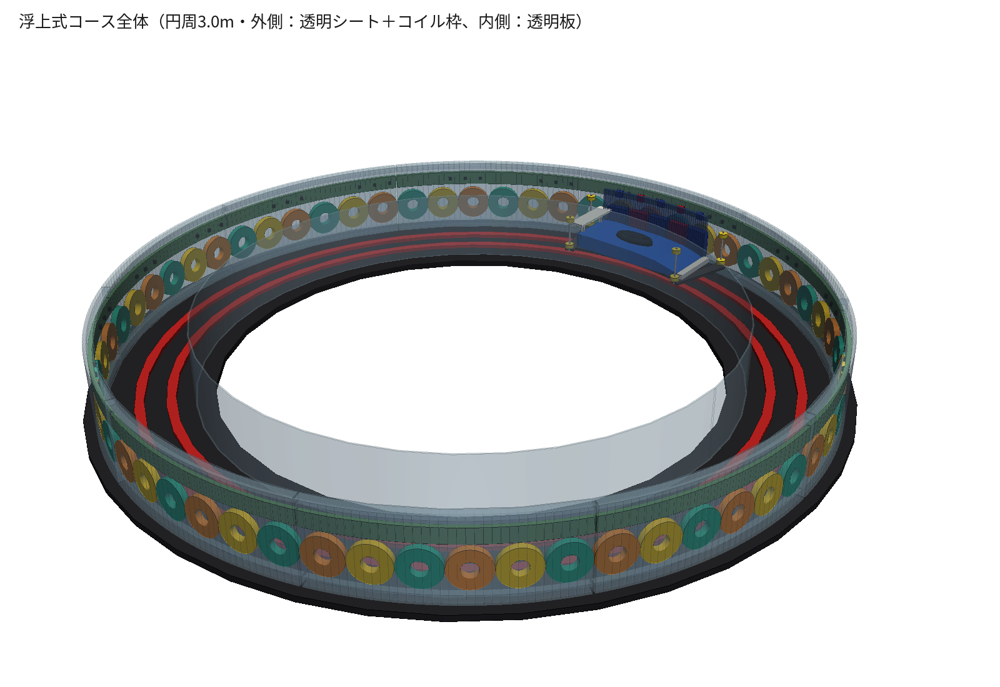
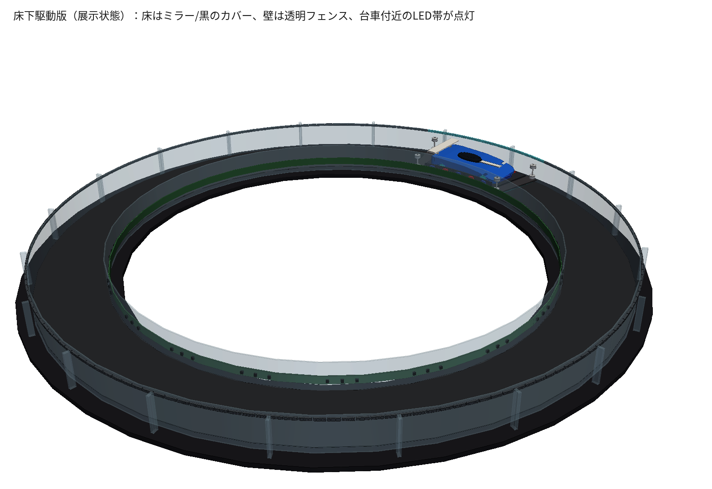

# maglev
高専のプレ卒業研究で製作する、卓上リニアモーターカーの設計資料です。

## 浮上式卓上リニアモーターカー「浮いてるミニ四駆」

設計資料一式をまとめています。チームの共有フォルダ（Google Drive）と同じフォルダ構成にし、CAD の生成スクリプトと描画スクリプトを加えています（2026-10-26 時点）。

- 円周 3.0 m の円形コースを、車輪のない台車が走ります。台車は床の磁石との同極反発で約 6 mm 浮きます
- 駆動方式は地上一次側のリニア同期モーター（LSM）です。コイル 60 個を 10 区間に分け、IGBT インバーター 1 台からリレーで区間を切り替えます
- 目標速度は 30 km/h です（基本波は約 111 Hz）
- 位置はホール IC 60 個で検出し、コース上のどこでも止めたり発進したりできるようにします

| | 第一案：側面駆動 | 第二案：床下駆動 |
|---|---|---|
| 全体図 |  |  |
| コイルの位置 | 外壁に縦向き | 床下に寝かせる |
| 台車の高さ | 約 92 mm | 約 40 mm |
| 磁石とコイルの距離 | 5 mm | 7 mm |
| 推力（見積もり） | 約 3 N | 約 2.6 N |

どちらの案にするかはまだ決まっていません。比較資料では第二案を推していますが、浮上と逆起電力を試作で確認してから決める前提です。数値の多くは計算値なので、試作で確かめる必要があります。

## フォルダ構成

```
リニアモーターカー仕様書.md        要求仕様 v0.3（第一案ベース。ファームウェア作成の元資料）
ソフトウェア設計/
  現行ソフトウェア仕様書.md        picofunc の現行実装と要求仕様の差分
  picofunc/                       インバーター信号源（YD-RP2040）のファームウェアと操作アプリ（picofunc の履歴ごと）
  hall_pattern_check.py           ホール IC の配置と台車の磁極で絶対位置が一意に決まるかの確認
ハードウェア設計/
  インバータの回路図.jpg
  浮いてるミニ四駆_第一案第二案比較.pdf   第一案と第二案の比較資料（A4 横・8 ページ）
  第一案/                          側面駆動：CAD モデル・STEP・図
  第二案/                          床下駆動：CAD モデル・STEP・図
  旧案_車輪あり/                    最初の案（車輪で走る版。不採用）
  比較資料_生成元/                  比較 PDF の生成スクリプトと切り抜き済みの図
```

各案のフォルダの中身は次のとおりです。

| ファイル | 内容 |
|---|---|
| `*_model.py` | CadQuery のモデル。実行すると STEP を書き出す |
| `*.step` | コース全体と台車のアセンブリ（Fusion 360 などで開ける） |
| `render_views.py` | 3D の図（PNG）を描く |
| `section_view.py` | 台車位置の断面図（PNG）を描く |
| `check_clearance.py` | 台車と固定部品の干渉と隙間を確認する |

第二案のモデルは、第一案の `maglev_course_model.py` にある関数を使います。そのため第二案のフォルダにも同じファイルを置いています。

第一案の断面図 `m_section.png` は、コイル枠を透明にした最新版です（Google Drive にある、枠が灰色の図より新しい版です）。

## 図と STEP を作り直す方法

```
pip install -r requirements.txt
cd ハードウェア設計/第二案
python maglev_floor_drive_model.py    # → maglev_floor_drive.step
python render_views.py                # → f_*.png
python section_view.py                # → f_section.png
python check_clearance.py             # 干渉チェック
```

- 図の日本語には Noto Sans CJK JP（`/usr/share/fonts/opentype/noto/NotoSansCJK-Regular.ttc`）を使います。比較 PDF には IPA P ゴシック（`/usr/share/fonts/opentype/ipafont-gothic/ipagp.ttf`）を使います。Windows で動かすときは、各スクリプト冒頭のフォントのパスを書き換えてください
- `render_views.py` は VTK の画面外描画を使います。1 枚の描画に数十秒かかります

## 関連

- インバーター信号源（YD-RP2040）のファームウェアと操作アプリ：`ソフトウェア設計/picofunc/`（元のリポジトリ：https://github.com/Arobberwhothreatenswithpunch/picofunc）
- 操作アプリ（PWA）：https://arobberwhothreatenswithpunch.github.io/picofunc/
